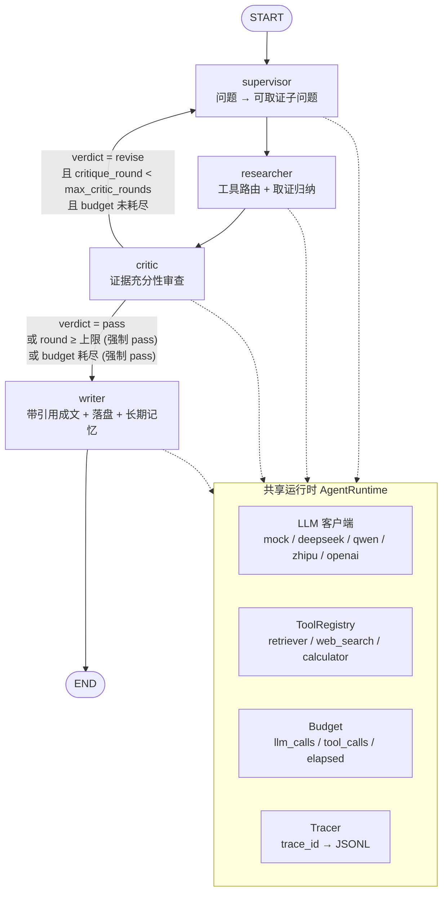

# Argus · 多智能体协同深度研究系统 —— 深度架构设计文档

> 面向读者：准备拿本项目去面试 Agent 开发岗的候选人，以及要考察他的面试官。
> 本文所有描述都对得上 `src/` 下的真实代码；每个关键结论后面都给出了 `文件:行号`，
> 便于按图索骥地验证。**读文档时请假设：凡文中提到的行为，都应该能在对应行号附近找到实现。**

代码版本：仓库快照 `__version__ = "0.1.0"`（`src/__init__.py:8`），Python 要求 `>=3.10`（`pyproject.toml`）。
核心依赖仅 LangGraph / langchain-core / langchain-openai / Pydantic v2 / rich / ddgs（`requirements.txt`、`pyproject.toml`）。

一句话概括：**用 LangGraph 把"规划 → 取证 → 审查 → 成文"四个角色编排成一条带返工回边的有向图，
用 Pydantic 做跨节点数据契约，用短期记忆 + 长期记忆 + JSONL trace + 三层护栏 + 离线可跑的评测，
把"多智能体系统很难调试、很难证明有效"这件事做成工程上可讨论的。**

---

## 0. 读前须知：如何在零 API Key 环境下验证本文

系统默认 `provider=mock`（`src/config.py:65`、`src/config.py:115`），LLM 层会返回一个**本地确定性替身模型**
`MockChatModel`（`src/llm.py:118`），它不发任何网络请求，只依据提示词里的 `[role=xxx]` 标记返回对应角色的
结构化占位 JSON（`src/llm.py:47`、`src/llm.py:51`）。因此：

```bash
python -m src.cli "多智能体系统落地的主要难点" --provider mock   # 跑一次完整图
python -m src.eval.run_eval --provider mock                    # 跑离线评测
pytest                                                          # 端到端图测试，无需外网
```

仓库里已经留下了 mock 模式的真实运行产物（`traces/*.jsonl` 共 7 份、`reports/*.md` 共 8 份），
它们的形状完全一致：**4 个事件（supervisor / researcher / critic / writer）、tool_calls=4、notes=8、
critic 在第 1 轮判 pass**。这正是本文第 10 节推算 mock 评测数字的经验依据。

---

## 1. 设计目标与非目标

### 1.1 要证明什么（Goals）

| 目标 | 本文对应做法 | 代码落点 |
| --- | --- | --- |
| G1 多智能体编排能力 | 四个单一职责角色 + LangGraph 有向图 + 条件边回流式返工 | `src/graph/orchestrator.py:48`、`src/agents/__init__.py` |
| G2 闭环自纠错（不是单向流水线） | Critic 产出 verdict/gaps，立即可执行的缺口回到 Supervisor 做**增量**重规划 | `src/agents/critic.py:48`、`src/agents/supervisor.py:60` |
| G3 记忆分层 | 短期（滑动窗口 + 摘要压缩）与长期（按用户 JSON 持久化）分离，并明确区分它们与 LangGraph checkpoint | `src/memory/short_term.py:53`、`src/memory/long_term.py:100`、`src/graph/orchestrator.py:68` |
| G4 可观测 | 每次运行一个 `trace_id`，每个节点一个 JSONL span，含耗时/成功/ counts，`utf-8` 追加写永不阻塞主链路 | `src/observability/tracer.py:74`、`src/observability/tracer.py:129` |
| G5 评测可复算 | 指标全部由 `run_research` 的返回值推导，不侵入节点；单样本失败不中断全集 | `src/eval/run_eval.py:169`、`src/eval/run_eval.py:195` |
| G6 护栏与降级 | 结构 / 事实 / 资源三层，护栏本身永不成为崩溃点；结构层优先降级，资源层强行终止 | `src/guardrails/checks.py:1-10`、`src/guardrails/checks.py:170` |
| G7 工程可用性（clone 即用） | 零 embedding 服务、零必需外部 API；可选依赖全部延迟导入并给中文提示 | `src/serving/api.py:116`、`src/tools/web_search.py:18` |

### 1.2 刻意不做什么（Non-Goals）

| 非目标 | 取舍理由（诚实版） |
| --- | --- |
| 不追求 SOTA 检索质量 | 目标是"编排闭环"而不是"检索"。召回用关键词 + 中文 bigram（`src/utils/text.py:22`），换向量只需替换 `LocalRetriever.retrieve` 的打分实现（`src/tools/retriever.py:100`），上层以 `retrieve() -> ToolResult` 编程，接口不变。 |
| 不做 embedding 服务 / 向量库 | 引入向量库就要引入模型下载、本地推理或付费 API，直接违反"clone 即用"。`requirements.txt` 里 `faiss-cpu` 与 `tiktoken` 是**注释掉的**可选依赖，`pyproject.toml` 的 `[rag]` extra 才开。 |
| 不做网页正文抓取 | `web_search` 只用 DuckDuckGo 返回的标题+摘要+链接（`src/tools/web_search.py:62`），没有正文下载、没有正文清洗。要更深的阅读器需要另加 fetch + 解析 + 去重，属于检索深度而非编排。 |
| 不做真实的完整 human-in-the-loop | 图支持 checkpoint 挂起，但当前没有 interrupt 与人工补充节点，也没有把控制权暴露到 API。这是"预留接口"而不是"已实现功能"。 |
| 不做流式输出 | `/research` 是同步 `invoke` 放进线程池（`src/serving/api.py:151`），没有 SSE / token 级流式。见局限清单 L9。 |
| 不做真实计费 | `estimate_tokens` 是字符级粗估（中文 1 字≈1 token，西文 4 字符≈1 token，`src/observability/tracer.py:26`），且当前实际写进 trace 的 token 数恒为 0（见 §9.4 的缺陷说明）。 |
| 不做多轮对话产品化 | 短期记忆层已实现但**未接入主链路**（只在单测里被覆盖），真正承载上下文的仍是 TypedDict state 与 MemorySaver。 |

### 1.3 一句话总结取舍

> **宁可出一份标注了"待验证"、引用可审计的报告，也不让自纠错闭环无限兜圈子去追求完美答案。**
> 这句话同时写在路由决策的注释里（`src/graph/orchestrator.py:35`）和资源护栏的注释里（`src/guardrails/checks.py:8`）。

---

## 2. 整体架构

### 2.1 控制流图（含返工条件边）



要点：

- **返工是图上的条件边，不是节点内部的 for 循环**（`src/graph/orchestrator.py:60`）。这带来两个收益：每一轮都有独立的 trace 事件（事后能看清"第几轮因为什么返工"），以及可以在返工边上挂 checkpoint 做人工介入（`src/graph/orchestrator.py:7-9`）。
- **回边指向 supervisor 而不是 researcher**。Critic 的产出是"缺口"，需要 Supervisor 重新翻译成可取证的子问题；同时 Supervisor 会做增量去重（`src/agents/supervisor.py:61`），已取证的子问题不会重复烧预算。
- 条件的三个分支在两处实现：图上的 `route_after_critic`（`src/graph/orchestrator.py:31`）与 Critic 节点内部的强制改写（`src/agents/critic.py:52-62`）。两者的关系见 §5.3 的一处诚实说明。

### 2.2 分层架构

```
┌─────────────────────────────────────────────────────────────────────────────┐
│ 接入层 Access                                                                │
│   src/cli.py (argparse)      src/serving/api.py (FastAPI)      src/serving/app.py (Streamlit) │
│   一次跑 + rich 表格/json     /research /health /traces         可视化面板 + 长期记忆统计      │
│   三者都只依赖一个入口：src.graph.run_research                                │
└─────────────────────────────────────────────────────────────────────────────┘
                                      │  run_research(query, user_id, cfg, thread_id)
┌─────────────────────────────────────────────────────────────────────────────┐
│ 编排层 Orchestration (LangGraph StateGraph)                                  │
│   graph/state.py      ResearchState(TypedDict) —— 共享黑板，可序列化          │
│   graph/orchestrator.py  add_node / add_edge / add_conditional_edges          │
│                          route_after_critic  ·  recursion_limit=25            │
│                          MemorySaver (可选 checkpointer) · thread_id           │
└─────────────────────────────────────────────────────────────────────────────┘
                                      │  每个节点收发的是 ResearchState 子集
┌─────────────────────────────────────────────────────────────────────────────┐
│ 角色层 Agents（闭包构造、闭包注入运行时）                                     │
│   supervisor  →  plan / pending                 (LLM x1)                     │
│   researcher  →  notes / done / tool_calls      (LLM x2 per 子问题)          │
│   critic      →  critique / issues / gaps / round (LLM x1)                   │
│   writer      →  report / references / citation_issues (LLM x1)              │
│   共享 AgentRuntime：llm / tools / tracer / budget / long_term                │
└─────────────────────────────────────────────────────────────────────────────┘
                    │                                        │
┌───────────────────────────────────────┐  ┌──────────────────────────────────┐
│ 工具层 Tools                           │  │ 记忆层 Memory                     │
│  registry.ToolRegistry（命名空间化）   │  │  short_term: 滑动窗口+摘要压缩     │
│  retriever（关键词/bigram 本地 RAG）   │  │  long_term : 按用户 JSON 原子写    │
│  web_search（DuckDuckGo）              │  │  两者与 checkpoint 职责互不重叠    │
│  calculator（AST 白名单求值）          │  └──────────────────────────────────┘
│  统一协议 (query, **kw) -> ToolResult  │
└───────────────────────────────────────┘
                                      │
┌─────────────────────────────────────────────────────────────────────────────┐
│ 基础设施 Infrastructure                                                       │
│   config.Settings（frozen 快照 / ARGUS_ 前缀）                                │
│   schemas（Pydantic v2 数据契约）  guardrails/checks（结构·事实·资源三层护栏） │
│   observability/tracer（JSONL span） eval/run_eval（指标） utils/text（分词）  │
│   prompts/prompts（角色提示词集中管理 + [role=] 标记）                         │
└─────────────────────────────────────────────────────────────────────────────┘
```

依赖方向严格自上而下：**接入层 → 编排层 → 角色层 → 工具/记忆 → 基础设施**。基础设施层不反向依赖上层，
唯一的例外是为了打破 `src.agents ↔ src.graph` 的导入环，`src/graph/__init__.py` 用了延迟导出（见 §11 F8）。

---

## 3. 角色职责表

四个角色都是"构造节点函数的闭包工厂"（`build_supervisor(runtime)` 的形式，`src/agents/__init__.py`），
运行时通过闭包注入，测试可以直接替换 `llm` 或 `tools` 字段而不用 monkeypatch 全局（`src/agents/runtime.py:29`）。

| 角色 | 输入（读 state） | 输出（写 state） | 失败时行为 | LLM 调用 |
| --- | --- | --- | --- | --- |
| **Supervisor**<br/>`src/agents/supervisor.py:37` | `query, user_id, gaps, plan, done` + 长期记忆上下文 | `plan, pending, llm_calls` | JSON 不可解析 / 计划为空 → `fallback_plan()` 模板兜底（`supervisor.py:56`），保证下游永远有输入 | 1 次/次执行 |
| **Researcher**<br/>`src/agents/researcher.py:38` | `pending, done, notes, tool_calls` + 工具可见列表 | `notes, pending=[] , done, tool_calls, llm_calls, errors` | 路由失败 → 退化为 `retriever`；工具异常 → 记录 `errors` 但不中断；归纳失败 → 该子问题无证据（不编造） | 2 次/子问题（router + 归纳） |
| **Critic**<br/>`src/agents/critic.py:27` | `query, plan, notes(done), critique_round` + budget | `critique, issues, gaps, critique_round, llm_calls` | 输出不可解 → 默认 `verdict=pass`（`checks.py:94`）；无证据却 pass → 强制 revise；到轮数上限或预算耗尽 → 强制 pass | 1 次/轮 |
| **Writer**<br/>`src/agents/writer.py:68` | `query, notes, trace_id, user_id` + 长期记忆上下文 | `report, references, citation_issues, llm_calls, budget_exhausted, finished=True` | 报告解析失败 → 用已确认证据拼"最小可用报告"（`writer.py:89-101`）；引用越界 → 自动剔除并留痕（`writer.py:106`） | 1 次 |
| **Router**（Researcher 的内嵌子角色）`src/prompts/prompts.py:68` | 单个子问题 + 可用工具名 | 不写 state，只服务 Researcher 内部 | 未选工具 → 退化为 `retriever`；未知工具名 → 注册表丢弃 | 计入 Researcher 的 2 次之一 |

### 3.1 一次默认运行的成本画像（可背的计算）

默认配置：`max_plan_items=4`、`max_tool_calls=3`、`max_critic_rounds=2`（`src/config.py:74-76`）。

- 单个 round：`Supervisor 1 + Researcher 2×4 + Critic 1 = 10` 次 LLM；工具 4 次（每子问题 mock 只选了 1 个工具）。
- 一次走完（含 Writer）：**11 次 LLM + 4 次工具调用**，Critic 1 轮。这与仓库里所有 mock trace 的 `llm_calls/tool_calls` 一致。
- 预算上限由 `AgentRuntime` 推导：`max_llm_calls = max_plan_items*4 + 6 = 22`、
  `max_tool_calls = max_plan_items*max_tool_calls + 2 = 14`、`max_seconds = 300`（`src/agents/runtime.py:43-48`）。
  注意这两组数字与 `Budget` 类的**默认值**并不相同（`20 / 12 / 300`，`src/guardrails/checks.py:173-177`），实际生效的是 runtime 传进去的那组。

> 面试要点：一次看似简单的问答，成本是"单次问答"的 10 倍以上。这就是为什么后面必须回答"什么时候不划算"。

---

## 4. 状态设计（黑板模式）

### 4.1 为什么是 TypedDict 而不是裸 dict

`ResearchState` 是一个 `TypedDict(total=False)`（`src/graph/state.py:17`）：

- **静态可读**：字段清单就是这份系统的"数据字典"，新人扫一眼就知道有哪些跨节点契约；IDE 与类型检查能挡住拼写错误。
- **`total=False` 是刻意的**：图允许中间节点提前返回，字段可以缺失。所有读取处都用 `.get(...)` 兜底（例如 `src/agents/critic.py:29`），
  `_to_response` 也逐个字段给了默认值以防某条链路没跑到就 500（`src/serving/api.py:75`）。
- **没有用 `Annotated[..., operator.add]` 累加器**：所有字段都是**替换语义**。因此节点要往列表里"追加"时，必须显式 read-modify-write，
  例如 Researcher 的 `"notes": existing_notes + new_notes`、`"done": done`（`src/agents/researcher.py:94-96`）。
  这是面试常被追问的点：**reducer 语义写漏了会静默丢数据**，这里选择了"显式 pits（坑）而不是隐式魔法"。副作用是 `errors` 每次由 Researcher 整体覆盖返回。

### 4.2 为什么要序列化友好

- LangGraph 的 checkpointer 需要把 state 落盘以支持断点续跑（`src/graph/state.py:1-6` 的注释明说），
  因此 state 里**不允许放 Pydantic 对象**，只存 `model_dump()` 出来的 dict（例如 `critique: dict[str, Any]  # Critique.model_dump()`）。
- 进出 object 形态靠两个转换器：`notes_from_state` / `references_from_state`（`src/graph/state.py:54`、`src/graph/state.py:69`），
  它们都会**跳过**校验不过的条目而不是抛异常——checkpoint 反序列化出来的坏数据不该让整条流水线失败。
- 目前用的是 `MemorySaver`（内存 checkpointer，`src/graph/orchestrator.py:68`），进程重启即失效；换成 SQLite/Redis 只需替换这一处的 checkpointer 对象。

### 4.3 字段生命周期表

| 字段 | 含义 | 谁写 | 谁读 | 生命周期 |
| --- | --- | --- | --- | --- |
| `query` / `user_id` / `trace_id` | 运行输入三件套 | `run_research` 初始化（`orchestrator.py:94`） | 全角色 | 全程只读 |
| `plan` | Supervisor 的完整计划 | Supervisor | Critic（判断覆盖率）、Supervisor（下一轮做 previous_plan） | 每轮可能被重写 |
| `pending` | **本轮待取证**的子问题队列 | Supervisor 计算；Researcher 执行后置空 | Researcher | 每轮重建 |
| `done` | 已取证过的子问题（跨轮累积） | Researcher | Supervisor（去重避免重复烧钱）、Critic（算 `uncovered`） | 单调增长 |
| `notes` | 证据列表（`Note.model_dump()`） | Researcher | Critic、Writer | 单调追加（手工 RMW） |
| `tool_calls` | 工具调用计数快照 | Researcher | 观测 / 评测 | 累加（手工 RMW） |
| `critique` | `Critique.model_dump()`，核心是 `verdict` | Critic | **路由函数** `route_after_critic` | 每轮覆盖 |
| `issues` / `gaps` | 审查指出的问题 / 下一轮必须补的缺口 | Critic | Supervisor（放入 `revision` 提示并重排 pending 优先级）、路由间接影响 | 每轮覆盖 |
| `critique_round` | 已完成几轮审查（进入 Critic 时 +1） | Critic | Critic（提示词里告诉模型"第 n/m 轮"）、路由（与上限比较） | 单调递增 |
| `max_critic_rounds` | 本轮上限 | 初始化时从 cfg 写入（`orchestrator.py:108`） | 路由、Critic | 只读 |
| `report` / `references` / `citation_issues` | 终产物与引用校验结果 | Writer | API / CLI / Streamlit / 评测 | 终点 |
| `llm_calls` | 预算计数的状态快照 | 各角色返回 `runtime.budget.llm_calls` | 观测 | 累加覆盖 |
| `errors` | 工具失败摘要 | Researcher（每次整体覆盖） | CLI / Streamlit 展示 | 每轮覆盖 |
| `budget_exhausted` | 预算耗尽标记 | 目前**只有 Writer** 写（`writer.py:141`） | 路由函数（实际效果见 §5.3） | 终点 |
| `finished` | 终态标记 | Writer 置 True | 测试断言（`tests/test_graph_mock.py:65`） | 终点 |

---

## 5. 控制流与返工闭环

### 5.1 一次完整执行的时序

```
调用方        run_research(query, user_id, cfg, thread_id)             orchestrator.py:74
  │
  ├─ ensure_sample_kb(cfg)                    知识库为空则写占位文档     registry.py:98
  ├─ AgentRuntime(cfg)                        建 llm/tools/tracer/budget runtime.py:39
  ├─ build_graph(runtime)                     编译，挂 MemorySaver      orchestrator.py:48
  ├─ app.invoke(initial, {"recursion_limit":25,
  │                       "configurable":{"thread_id": thread_id or trace_id}})
  │
  │  ── round 1 ──────────────────────────────────────────────────────────
  │  supervisor(plan=[q1..q4], pending=[q1..q4])            LLM#1
  │  researcher: for sq in pending:                         LLM#2..#9
  │       router -> run_plan(max_calls=3) -> ToolResult[]   tools#1..#4
  │       归纳 -> notes[]，逐条回填 subquestion
  │       done += sq          → notes=8, tool_calls=4
  │  critic: round_index = state.critique_round + 1 = 1      LLM#10
  │       ① round>=max? 否  ② budget.exhausted? 否
  │       ③ 无 notes 且 pass? 否        → 保留模型给的 verdict
  │  route_after_critic(state):
  │       verdict=="revise" AND round<max AND NOT budget_exhausted ?
  │          是 → "supervisor"（进入 round 2）  否 → "writer"
  │
  │  ── round N (仅当 revise) ────────────────────────────────────────────
  │  supervisor: 带 gaps 做增量重规划
  │       pending = [plan 中不在 done 的项]，并把未完成的 gaps 插到队首
  │  researcher: 只跑 pending —— 已经取过证的子问题不重复付费
  │  critic: round_index 再次 +1
  │
  │  ── 终止 ────────────────────────────────────────────────────────────
  │  writer: 证据 -> 结构化引用 -> 报告 -> 落盘 -> 高置信事实写入长期记忆  LLM#last
  └─ return {"state", "summary", "report_path"}
```

### 5.2 三重终止条件

| 条件 | 判定位置 | 行为 |
| --- | --- | --- |
| **C1 轮数上限** | `Critic` 内强制改写（`critic.py:52-55`）+ 路由比较 `round_index < max_rounds`（`orchestrator.py:42`） | 到达 `max_critic_rounds`（默认 2）时，Critic **直接把 verdict 改成 pass 并清空 gaps**，无论模型怎么说。这是防无限循环的第一道，而且是"双写"的——即使路由分支被绕过也安全。 |
| **C2 预算耗尽** | `Budget.exhausted`（`checks.py:196`）在 Critic 内被读（`critic.py:56`） | LLM 调用 ≥22、工具调用 ≥14 或耗时 ≥300s 任一成立 → 强制 pass + 清空 gaps，直接出稿。 |
| **C3 verdict 本身** | `route_after_critic`（`orchestrator.py:42`） | verdict 必须是 `revise`（其它值一律视为放行，`checks.py:99` 已把非法值归一为 `pass`）。 |

外加两层"兜底安全网"：

- **LangGraph `recursion_limit=25`**（`orchestrator.py:118`）：万一三个条件全被绕过（例如有人把 `max_critic_rounds` 配成很大），
  图会在 25 步后抛 `GraphRecursionError`，而不是无限转。
- **Critic 的默认 pass 语义**（`checks.py:94`）：模型输出乱码时**不返工**。宁可漏放，不可陷入无效重试——这是自纠错系统的经典反向默认值。

### 5.3 一处诚实说明：`budget_exhausted` 在路由里的检查目前是"死分支"

`route_after_critic` 读的是 `state["budget_exhausted"]`（`orchestrator.py:43`），而在整条链路里只有 **Writer** 写这个字段
（`writer.py:141`），而 Writer 之后就是 END。也就是说在返工决策发生的时刻，这个字段永远是初始的 `False`。

实际起作用的预算闸门是 **Critic 节点内部对 `runtime.budget.exhausted` 的直接检查**（`critic.py:56`）——那个 budget 对象是真实计数器。
结论：**系统的防失控并不依赖这个死分支**，但如果要动这段代码，正确修法是让 Supervisor 或 Researcher 在节点返回时
发布 `"budget_exhausted": runtime.budget.exhausted`，或者让路由直接读 runtime。这也是一个可以在面试里主动指出的改进点。

### 5.4 返工时如何避免重复烧钱

Supervisor 的增量重规划（`supervisor.py:60-65`）：

```python
pending = [item for item in plan.plan if item not in done]   # 已取证的不重试
if gaps:                                                     # Critic 的缺口优先
    ordered = [gap for gap in gaps if gap not in done]
    pending = ordered + [item for item in pending if item not in ordered]
```

配合 Researcher 里 `"pending": []` 的清空（`researcher.py:95`），形成"队列驱动"模型：**每轮只为本轮新增的 pending 付费**。

---

## 6. 记忆分层

这是面试高频误区区，本节刻意写细。三者的**职责边界**：

| 层 | 实现 | 存什么 | 生命周期 | 谁负责 |
| --- | --- | --- | --- | --- |
| **短期记忆** | `ShortTermMemory`（`memory/short_term.py:33`） | 会话内的轮次原文 + 事实摘要 | 进程内对象，随任务结束消亡 | 应用层（`threshold` 默认 4000 字符，与 `ARGUS_MEMORY_SUMMARY_THRESHOLD` 同名同值，`config.py:87`） |
| **长期记忆** | `LongTermMemory`（`memory/long_term.py:67`） | 按用户的事实 + 偏好 | 落盘 `.memory/<user>.json`，跨进程跨会话 | 应用层（Supervisor 读上下文、Writer 写高置信事实） |
| **LangGraph checkpoint** | `MemorySaver`（`orchestrator.py:68`） | `ResearchState` 的完整快照 | 按 `thread_id` 命名空间，进程内内存 | 框架层 |

### 6.1 短期记忆：滑动窗口 + 摘要压缩

```python
def compact(self) -> None:                       # short_term.py:53
    old, self.turns = self.turns[:-keep_recent], self.turns[-keep_recent:]   # 只留最近 keep_recent=6 轮原文
    # 抽取式压缩：每轮保留首句（通常是结论句）的前 120 字符，总预算 800 字符
    self.summary = f"[历史摘要 #{n}] {body}"
```

- **不依赖 LLM 做摘要**：用"保留首句 + 长度上限"的抽取式压缩，保证离线可用、可测试。
- 触发条件：追加后 `total_chars > threshold`（`short_term.py:46`）。
- **现状**：这一层目前只在 `tests/test_tools_and_memory.py` 里被覆盖，**没有接入 `ResearchState` 或任何角色**。
  也就是说当前多轮上下文的真实载体仍然是 state + checkpoint。这是明确的待办，而非已实现能力（局限 L6）。

### 6.2 长期记忆：按用户持久化

```python
@staticmethod
def _safe_id(user_id):                            # long_term.py:77
    safe = "".join(ch for ch in user_id if ch.isalnum() or ch in "-_")   # 防路径穿越
    return safe or "default"
```

| 机制 | 实现 | 说明 |
| --- | --- | --- |
| 存储粒度 | `.memory/<safe_user_id>.json` | 不同用户天然隔离；非法字符被过滤（`tests/test_tools_and_memory.py:366` 专门测了 `../` 场景） |
| 原子写 | `tempfile.mkstemp` → `json.dump` → `os.replace`（`long_term.py:109-113`） | 写入过程中进程被 kill 也不会留下半个坏文件；`finally` 里清理临时文件 |
| 读降级 | `_load` 捕获 `OSError / JSONDecodeError` 返回 `[]`（`long_term.py:89`） | 文件损坏 → 退化为空记忆，而不是让整条流水线 500 |
| 写入去重 | `add` 按 content 全等去重，重复内容只刷新 `source`（`long_term.py:119`） | 防止同一条事实反复堆积 |
| 容量淘汰 | `_trim`：`limit = ARGUS_MEMORY_MAX_ITEMS`（默认 200，`long_term.py:138`） | **偏好(`preference`) 全部保留**，事实按 `(hit_count, created_at)` 降序保留；即"用户偏好 > 被反复命中的旧事实 > 冷数据" |
| 召回 | `recall`：关键词重叠 / 查询词数，与 RAG 共用同一套分词（`long_term.py:150`、`long_term.py:58`） | 刻意复用 `utils.text_tokens`，保证"检索口径与记忆口径一致" |
| 注入点 | `as_context`（`long_term.py:171`）→ Supervisor 与 Writer 的提示词 | 命中即 `hit_count += 1` |

两个诚实的细节：

1. `recall` 里累加的 `hit_count` **不会自动持久化**——只有 Writer 在写事实时会调用 `save()`（`writer.py:125`）。
   也就是说 Supervisor 侧的召回命中在当前实现里对 `_trim` 的排序贡献是一次性的、易失的（局限 L7）。
2. 写入门槛是 `confidence >= 0.7`（`writer.py:23`、`writer.py:121`）。**mock 模型的占位证据置信度恒为 0.6**（`llm.py:76`、86），
   所以在 mock 模式下长期记忆永远不会被写入——这解释了为什么仓库里的 `.memory/` 是空目录。

### 6.3 checkpoint 不是"记忆"（面试必答）

> **checkpoint 负责"这张图执行到哪一步了"；短期记忆负责"上下文预算怎么花"；长期记忆负责"这个人以前问过什么/喜欢什么格式"。**

具体区别：

- checkpoint 由框架写入，开发者一般不去动它，内容就是 `ResearchState` 的全量快照；
- checkpoint 不会因为 token 不够而压缩任何东西，它只管**状态完整性**；
- checkpoint 的命名空间是 `thread_id`（`orchestrator.py:121` 用 `thread_id or trace_id` 兜底），跟用户无关；长期记忆的命名空间是 `user_id`；
- 想实现 human-in-the-loop（在 critic 返工前挂起等人工补料），靠的是 checkpoint + interrupt，而不是记忆层。

---

## 7. 工具调用

### 7.1 为什么让模型做路由（router 角色）

`router_messages`（`prompts.py:68`）把"可用工具"和"选择原则"交给模型，输出 `{"tools": [...], "queries": {...}}`：

- **不写死 pipeline**：不同子问题的最优取证路径不同（术语定义该查本地库、时效数据该联网、同比该计算），写死就失去泛化。
- **成本可控优先**：原则里明确"能用本地知识库解决的优先 retriever"（`prompts.py:83`），相当于把成本策略写进提示词。
- **模型只见名字不见对象**：注册表只把名称列表给 router（`researcher.py:43` 的 `runtime.tools.names`），模型拿不到真实实现，天然少一层注入面。

### 7.2 注册表如何兜底（`src/tools/registry.py`）

| 风险 | 处置 | 代码 |
| --- | --- | --- |
| 未知工具名 | `execute` 返回 `ToolResult(ok=False, error=f"未知工具: {name}")`，**不抛异常** | `registry.py:55-56` |
| 工具实现自身抛异常 | `try/except Exception` 收敛成失败 `ToolResult`，附带异常类型与消息 | `registry.py:57-62` |
| route 不是 Mapping（模型返回数组/null） | `run_plan` 直接返回空列表 | `registry.py:72-73` |
| 工具名写了但没注册 | `run_plan` 用 `str(item) in self` 先过滤（依赖 `__contains__`），不存在就不执行 | `registry.py:75` |
| 调用次数超限 | `tools[:max_calls]` 截断，`max_calls` 来自 `ARGUS_MAX_TOOL_CALLS` | `registry.py:78` |
| queries 字段形态异常 | 非 Mapping 时统一回退成空字符串 | `registry.py:79` |
| 模型压根没选工具 | Researcher 侧退化为 `retriever`（低于 Supervisor 兜底计划一级） | `researcher.py:62-63` |
| 工具返回空输出 | `_render_evidence` 渲染成 `<tool 调用失败: ...>`，让 Researcher 看到"这里没有证据"而不是静默成功 | `researcher.py:24-32` |

### 7.3 calculator 的 AST 白名单安全性

不用裸 `eval`，而是 `ast.parse(mode="eval")` 后递归白名单求值（`calculator.py:48-83`）：

| 白名单 | 内容 |
| --- | --- |
| 常量 | `ast.Constant` 且必须是 `int/float`（布尔等其他类型直接走到 raise）；另有 `pi` / `e` 两个 `ast.Name` |
| 二元运算 | `Add Sub Mult Div FloorDiv Mod Pow` 七种运算符表（`calculator.py:20`） |
| 一元运算 | `UAdd USub`（`calculator.py:29`） |
| 函数 | `abs round min max sum len sqrt log pow`（`calculator.py:30`），且要求 `func` 必须是裸 `ast.Name` |
| 结果类型 | `isinstance(result, bool)` → 拒绝；非数值 → 拒绝（`calculator.py:81`） |

**被挡住的典型攻击面**：`__import__("os").system(...)`（属性访问与下标不在白名单 → raise）、
`open("/etc/passwd").read()`（函数调用名不在白名单）、`().__class__.__bases__[0]`（属性访问）、
`9**9**9` 这种资源炸弹（这一层**不挡**，属于 DoS 而非注入，见局限 L11）、变量赋值/比较/lambda（mode="eval" 本身就不允许语句）。

遇到非法表达式时返回 `ToolResult(ok=False)` 而不是抛出（`calculator.py:98-104`），符合注册表的统一协议。

### 7.4 retriever：为什么不用向量库

- `LocalRetriever` 预先把 `data/sample_kb` 下 `.md/.txt/.markdown` 按**空行分段再滑窗 500 字符**切块（`retriever.py:73-97`），索引一次性建好后缓存在 `_chunks`。
- 打分：`overlap / len(query_tokens)`（归一化，避免长查询天然占优）再乘 `min(1.5, 1 + len(chunk)/2000)`（轻微偏好长块，避免总命中标题这种短片）。标题本身也作为一个伪 chunk 入库，作为"文章级"弱信号。
- 可解释、可复现 → 可以写确定性单测（`tests/test_tools_and_memory.py:150-181` 断言了命中/未命中/queries 为空/目录不存在）。
- 要升级成向量检索，**只需替换 `retrieve` 的 scoring，调用方 `(query) -> ToolResult` 接口不变**（`retriever.py:1-10` 的模块注释明确写了这一点）。

---

## 8. 护栏与降级策略（三层）

分层原则（`guardrails/checks.py:1-10`）：**结构层与事实层优先降级而不是中断**——研究任务本身允许部分信息缺失；
**资源层强行终止**——钱和时间的边界不容协商。

### 8.1 结构层：把"模型不一定返回合法 JSON"当成常态

| 场景 | 护栏 | 降级动作 | 代码 |
| --- | --- | --- | --- |
| 输出被 ` ```json ` 包裹 / 前后夹带废话 / 返回顶层数组 | `extract_json` 三层候选：原文 → 去代码块 → 截取首个 `{...}`/`[...]` 片段 | 拿到就解析，拿不到返回 `None` | `llm.py:188-212` |
| Supervisor 的 plan 非法（非 dict / plan 非 list / Pydantic 校验失败） | `parse_plan` 返回 `Plan(plan=[])` | 上层用 `fallback_plan()` 模板生成 4 条"定义边界 / 主流路线 / 量化数据 / 风险争议"子问题，流水线继续 | `checks.py:36`、`supervisor.py:56` |
| plan 条数超限（提示词里写了不超过 n，模型仍会超） | `plan[:min(limit, 8)]` 硬性截断，另有 `_MAX_PLAN_ITEMS_HARD=8` 绝对上限 | 截断后继续 | `checks.py:33`、`checks.py:48` |
| Researcher 的某条 note 字段畸形（confidence 越界 / claim 为空 / 类型错） | `parse_notes` 逐条 try，坏条跳过 | **保留其余有效证据**，最后再过滤掉空 claim | `checks.py:52-77` |
| Critic 的 verdict 是空值/拼写错/大写 | 归一：非 `{pass, revise}` 一律 `pass` | 不返工（避免无效重试拖死自己） | `checks.py:94-108` |
| Critic 的 issues/gaps 是 `null`、字符串、或夹杂数字 | `_string_list` 统一容错，限长 10 条 | 保证护栏本身不是崩溃点 | `checks.py:79-91` |
| Writer 的 report 为空 | `parse_report` 返回 `None` | 用**已确认的证据**拼最小可用报告：`{i}. {claim} [{i}]`，无证据则写"未获取到可用证据" | `checks.py:111`、`writer.py:89-101` |
| Writer 的 references 有重复 id / id<=0 / 字段缺失 | id 去重（保留首次出现）、缺失 id 用 enumerate 下标兜底、坏项跳过 | 继续成文 | `checks.py:119-145` |
| 证据/工具输出过长撑爆上下文 | `ToolResult.output` 截断 4000 字符（Pydantic validator 自动生效）+ `truncate_evidence` 截断 6000 字符 | 加 `…[truncated]` 标记，避免悄悄丢 | `schemas.py:42`、`checks.py:163` |

### 8.2 事实层：防止引用编造

| 场景 | 护栏 | 降级动作 |
| --- | --- | --- |
| 正文出现 `[n]`，但参考列表里没有 id=n | `validate_citations` 返回 `[f"正文引用 [{i}] 在参考列表中不存在（疑似编造引用）"]` | `strip_invalid_citations` 用正则**删掉越界的 `[n]` 标记**、压缩多余空白，并把问题清单留在 `state["citation_issues"]` 供审计（`writer.py:106`、`writer.py:49`）。注意这里删掉的是**标记**而不是把结论抹掉——结论还在，但它不再伪装成有出处。 |
| 完全没有引用标记 | `validate_citations` 返回空列表（不惩罚"没引用"，只惩罚"假引用"） | 正常通过 |  | `checks.py:150` |
| 证据为空时 Researcher 编造 | 提示词硬约束"证据为空返回空 notes 数组"（`prompts.py:109`）+ 结构层不会凭空造 note | 该子问题无证据 |
| 无证据却被判通过 | Critic 内部硬规则：`not has_notes and verdict == pass` → 强制 `revise`，gaps 兜底为 `gaps 或 未覆盖计划 或 ["补一条最基础的可用证据"]` | 强制返工一次（`critic.py:59-62`） |

### 8.3 资源层：预算与超时

```python
@property
def exhausted(self) -> bool:                       # checks.py:196
    return (self.llm_calls >= self.max_llm_calls
            or self.tool_calls >= self.max_tool_calls
            or self.elapsed >= self.max_seconds)
```

| 资源 | 默认上限 | 来源 | 超限时行为 |
| --- | --- | --- | --- |
| LLM 调用 | `max_plan_items*4 + 6 = 22` | `runtime.py:45` | Critic 强制 `verdict=pass` 且清空 gaps → 直接进 Writer（`critic.py:56-58`） |
| 工具调用 | `max_plan_items*max_tool_calls + 2 = 14` | `runtime.py:46` | 同上 |
| 墙钟时间 | 300 秒 | `runtime.py:47` | 同上 |
| 图步数 | `recursion_limit = 25` | `orchestrator.py:118` | LangGraph 抛 `GraphRecursionError`（最后的硬停止） |

注意两处实现细节：

- `invoke_llm` 是**先扣预算再发请求**（`runtime.py:59-61`），所以"还剩最后一次调用"时那一通一定会发出去，扣完立即 `exhausted=True`。
  这保证不会出现"预算判了可用但发出去后才发现超了"的竞态。
- 资源护栏**不会抛出异常去中断任务**，而是改变控制流走向"尽快出稿"。这就是设计目标里那句"宁可出一份标注待验证的报告"。

---

## 9. 可观测性

### 9.1 trace 数据结构（字段清单）

`TraceEvent`（`tracer.py:35`）逐字段：

| 字段 | 类型 | 含义 | 来源 |
| --- | --- | --- | --- |
| `trace_id` | str | 12 位十六进制（`uuid4().hex[:12]`，`tracer.py:58`），一次运行一个 | Tracer 构造时生成 |
| `node` | str | `supervisor` / `researcher` / `critic` / `writer` | `span(node, ...)` 参数 |
| `started_at` | str | `datetime.now().isoformat(timespec="seconds")` | span 入口 |
| `elapsed_ms` | int | `perf_counter` 差值 | span 出口 `finally` |
| `ok` | bool | 未抛异常为 True | span 的 try/except |
| `error` | str | `"{异常类型}: {消息}"` | 同上 |
| `tokens_in` / `tokens_out` | int | `estimate_tokens(input/output)` 粗估 | 见 §9.4 缺陷 |
| `meta` | dict | 节点自定义 fields；非 verbose 模式下被白名单过滤为 `{tool_calls, llm_calls, notes, round, verdict}` | `tracer.py:101-109` |

`Tracer.summary()` 返回（`tracer.py:129`）：`trace_id`、`elapsed_ms`（所有 span 之和）、`events`、`failed_nodes`、
`tokens_in` / `tokens_out` 总计、`per_node[{count, elapsed_ms, tokens_in, tokens_out}]`、`trace_file`；
`AgentRuntime.summary()` 再叠加 `budget` 快照（`runtime.py:85`），这是 CLI / API / 评测统一的观测出口。

### 9.2 如何用 trace_id 串联一切

```
报告文件： reports/<trace_id>.md              writer.py:110
追踪文件： traces/<trace_id>.jsonl             tracer.py:70
长期记忆： MemoryItem.source = trace_id        writer.py:124
检查点  ： MemorySaver 命名空间 thread_id      orchestrator.py:121
HTTP    ： GET /traces/<trace_id>              api.py:183
```

即：**一次运行的产物、证据来源、检查点、链路，全部可用同一个 id 反查**。这是把"多智能体不可调试"变成"能复盘"的最小成本做法。

### 9.3 trace JSONL 示例（真实文件摘录）

以下是仓库里 `traces/a01c697af6ae.jsonl` 的真实四行（mock provider，默认 `ARGUS_TRACE_VERBOSE=false`）：

```jsonl
{"trace_id": "a01c697af6ae", "node": "supervisor", "started_at": "2026-10-14T21:01:45", "elapsed_ms": 0, "ok": true, "error": "", "tokens_in": 0, "tokens_out": 0, "meta": {}}
{"trace_id": "a01c697af6ae", "node": "researcher", "started_at": "2026-10-14T21:01:45", "elapsed_ms": 2, "ok": true, "error": "", "tokens_in": 0, "tokens_out": 0, "meta": {"tool_calls": 4, "notes": 8}}
{"trace_id": "a01c697af6ae", "node": "critic", "started_at": "2026-10-14T21:01:45", "elapsed_ms": 0, "ok": true, "error": "", "tokens_in": 0, "tokens_out": 0, "meta": {"verdict": "pass", "round": 1, "notes": 8}}
{"trace_id": "a01c697af6ae", "node": "writer", "started_at": "2026-10-14T21:01:45", "elapsed_ms": 2, "ok": true, "error": "", "tokens_in": 0, "tokens_out": 0, "meta": {}}
```

开启 `ARGUS_TRACE_VERBOSE=true` 后 `meta` 保留全量字段，形态示意（非仓库文件）：

```jsonl
{"trace_id": "a01c697af6ae", "node": "critic", "started_at": "2026-10-14T21:01:45", "elapsed_ms": 0, "ok": true, "error": "", "tokens_in": 0, "tokens_out": 0, "meta": {"verdict": "pass", "round": 1, "notes": 8, "gaps": 0, "input": "多智能体系统落地...| notes=8", "output": "{\"verdict\": \"pass\", \"issues\": [], \"gaps\": []}"}}
{"trace_id": "a01c697af6ae", "node": "supervisor", "started_at": "...", "elapsed_ms": 0, "ok": true, "error": "", "tokens_in": 0, "tokens_out": 0, "meta": {"plan_items": 4, "pending": 4, "input": "...", "output": "{\"plan\": [...]}"}}
```

因为每行都是独立合法 JSON，`jq` / pandas 可直接分析：

```bash
jq -r 'select(.node=="critic") | [.started_at, .meta.verdict, .meta.round] | @tsv' traces/a01c697af6ae.jsonl
```

### 9.4 两处值得注意的实现缺陷（诚实列出）

1. **`tokens_in` / `tokens_out` 恒为 0**。`tracer.py:91` 取的是 `payload = box.get("meta", meta)`，
   随后 `payload.get("input")` / `payload.get("output")` —— 这两个 key 实际写在 `box` 上（`supervisor.py:68`、`researcher.py:90` 等），
   而不是写在 `meta` 里。因此 token 统计永远读不到内容。上面摘录的 7 份真实 trace 全是 0，是这个问题的直接证据。
   修法：把 `payload` 换成 `box`（或与 `box["meta"]` 分开取值）。
2. **节点重设 `meta` 会覆盖 span 的入参**。`Tracer.span(node, **meta)` 的 kwargs 被塞进 `box["meta"]`，而节点随后又
   `box["meta"] = {...}`（`supervisor.py:67`、`critic.py:64`），于是 supervisor 的 `round=`、researcher 的 `pending=` 全部丢失。
   加上白名单过滤，导致 **supervisor 与 writer 的 `meta` 在默认模式下恒为 `{}`**（同上，见真实 trace 第 1、4 行）。

两点都**不影响正确性**（trace 只做留痕），但会让"成本分析"失真——这也是局限 L4 的一部分。

### 9.5 怎么接 LangSmith

`configure_tracing`（`tracer.py:153`）做的事只有一件：如果 `ARGUS_LANGSMITH=true`，就设置 LangChain 的云端 trace 环境变量：

```python
os.environ["LANGCHAIN_TRACING_V2"] = "true"
os.environ.setdefault("LANGCHAIN_PROJECT", cfg.langsmith_project)   # 默认 argus-research
```

之后 LangChain / LangGraph 的原生回调会把**每次 LLM 调用**上报到 LangSmith（`langsmith` 在 `requirements.txt` 的 `trace` extra 里）。

需要诚实说明的一点：**`configure_tracing` 目前没有被 `AgentRuntime` 调用**（`runtime.py:42` 用的是 `Tracer(cfg=cfg)`），
所以单靠 `ARGUS_LANGSMITH=true` 环境变量不会生效；要么自己先 export `LANGCHAIN_TRACING_V2=true`，要么把 runtime 里的构造替换为 `configure_tracing(cfg)`。
另外：**图级别的节点 span 只落在本地 JSONL**，不会自动上报 LangSmith，因为它们是自定义的 `Tracer.span`，没有走 LangChain callback。
想把它也上云，正确做法是把 `Tracer.span` 映射成 LangSmith run（或用 LangGraph 自带的 callback / tracer）。这是局限 L8。

---

## 10. 评测方法论

### 10.1 `EvalSample` 结构（`run_eval.py:83`）

```python
class EvalSample(BaseModel):
    question: str                        # 要研究的开放式问题
    must_include: list[str] = []         # 期望出现在报告或证据中的关键词/关键结构
    reference_objects: list[str] = []    # 可选：期望产物形态描述，仅供人工复核
```

刻意**没有** `extra="forbid"`：评测集由人手写，允许带备注字段，附加字段不该让整行样本失效（`run_eval.py:85-88` 的注释）。
`load_dataset` 对不存在的文件返回空列表、对坏行跳过（`run_eval.py:101-122`）。

当前数据集：`eval/datasets/sample.jsonl`，**6 条中文样本**，每条 3 个 `must_include` 关键词（如 `["技术路线","可控性","风险"]`）。

### 10.2 指标定义

每条样本跑一次**完整图**（`run_research`），指标全部从返回值推导，不侵入任何节点。

| 指标 | 定义 | 为什么需要它 | 局限 |
| --- | --- | --- | --- |
| 出稿率 `has_report_rate` | 有非空报告正文的样本占比（state 为空时回退读落盘文件，`run_eval.py:125`） | 最基础的"能不能用"——多智能体最常见的失败是链路断在半路 | 有稿 ≠ 有质量 |
| 引用合规率 `citation_valid_rate` | `state["citation_issues"]` 为空即合规 | 引用可审计是本项目的核心卖点；这是可以直接复算的事实性指标 | 只查编号越界，**不查引用与结论是否真的对应** |
| 关键词召回 `keyword_recall` | `must_include` 中出现在（报告 ∪ 证据 claim）里的比例；`must_include` 为空时记 1.0 | 廉价的"有没有覆盖到核心概念"代理指标，无需 gold answer | 是字面包含匹配，同义词改写就会漏；写"评测"和"评估"得分不同 |
| 证据条数 `notes_count` | `len(state["notes"])` | 取证环节的产出量；掉到 0 说明工具或归纳挂了 | 数量不代表质量，重复 claim 也会计数 |
| 引用数 `citation_count` | 正文里 `[n]` 去重后的编号个数 | 衡量"结论是否真的挂了出处" | 任一真实存在即算合规，无法识别"引用了但答非所问" |
| LLM 调用 / 工具调用 | 来自 budget 快照 | **多智能体的核心代价**，必须和收益一起看 | 是调用次数不是 token；真实 token 计数缺失（见 §9.4、局限 L4） |
| Critic 轮数 `critique_rounds` | `state["critique_round"]` | 观察返工机制到底有没有被触发 | mock 下恒定 1 |
| 耗时 `elapsed_ms` | 所有 span 的 `elapsed_ms` 之和 | 用户体验红线的代理指标 | 只是节点内部耗时之和，**不含 LLM 往返之外的编排开销**（见 §9.4 的计时注释 `runtime.py:62`） |

聚合时对这些数值指标取均值（`run_eval.py:56`、`run_eval.py:237-243`）；每条样本使用独立 `thread_id=eval-<uuid8>`，
既满足 checkpointer 的强制要求，又保证样本之间不共享状态（`run_eval.py:186-194`）。

### 10.3 示例输出（mock 模式）

```console
$ python -m src.eval.run_eval --provider mock

                              Argus 评测汇总
┌──────────────────┬──────────┐
│ 指标             │     数值 │
├──────────────────┼──────────┤
│ 样本数           │        6 │
│ 出稿率           │      1.0 │
│ 引用合规率       │      1.0 │
│ 关键词召回       │      1.0 │
│ 报告字数         │    177.0 │
│ 证据条数         │      8.0 │
│ 引用数           │      1.0 │
│ 工具调用         │      4.0 │
│ LLM 调用         │     11.0 │
│ Critic 轮数      │      1.0 │
│ 耗时 (ms)        │      5.0 │
└──────────────────┴──────────┘
```

说明（重要，别把这张表当成成绩单）：

- 上表是 **mock provider 下的示例输出**，源自对 mock 确定性行为的逐项推算（未联网执行），指标名称与列顺序与
  `_TABLE_ROWS`（`run_eval.py:68`）一致；除耗时外，其余数字都可以手算验证：
  每份样本 4 个子问题 → 8 次证据归纳 LLM（4×(router+归纳)=8）、加上 Supervisor/Critic/Writer 共 **11 次 LLM**；
  工具 4 次；mock 的 8 条证据去重后得到 2 条参考来源、正文只出现 `[1]`；`report_chars=177` 是占位报告正文的字符数。
  耗时在真实环境约为 4~7 ms 量级（mock 不发网络请求），此处取 5.0 作为示意。
- **这张表恰恰暴露了评测的局限**：mock 模式下关键词召回恒为 1.0、出稿率恒为 1.0、引用合规率恒为 1.0，
  三个质量指标全部饱和、毫无判别力。它的价值在于**验证评测管线本身跑得通**（这也是 CI 里的用途），
  而不是证明系统好用。**真正的结论必须靠真实 provider 跑出来。**

### 10.4 评测的局限（诚实）

1. **样本量太小**：6 条自写中文样本，没有标准答案、没有难度分层、没有对抗样本。统计上几乎无意义。
2. **没有 LLM-as-judge**：`reference_objects` 字段设计出来是给人工复核用的，当前**没有任何自动化消费它**。
   所以"报告写得好不好"这一半完全没被度量；本文 §12 把它列为第一优先级改进。
3. **LLM-as-judge 本身的偏差**（如果后续要加）：位置偏差（偏好靠前的选项）、长度偏差（偏好长文本）、
   自我偏好（同一模型偏好自己的输出）、以及评分不可复现。**必须**配 rubric 打分 + 多次采样取平均 + 与人工标注做相关性校验，
   否则只是把"我觉得变好了"包装成一个数字。
4. **离线/在线分布不一致评测缺少**：没有工具失败注入（比如强制 web_search 超时）去看降级路径是否真的健壮。

---

## 11. 失败模式清单

全部来自代码里的真实处理逻辑，不是设想。

| # | 现象 | 根因 | 处置（代码） |
| --- | --- | --- | --- |
| F1 | 模型不返回 JSON / 返回空 | 采样随机性、超长输出被截断 | `extract_json` 三层候选后仍为 `None` → 各角色各自走兜底降级：Supervisor 用 `fallback_plan` 模板（`supervisor.py:56`）；Writer 用已确认证据拼最小报告（`writer.py:89-101`）；Critic 默认 pass（`checks.py:94`） |
| F2 | 输出被 ```json 代码块包裹或前后夹带解释 | 模型没遵守"只输出 JSON" | `extract_json` 去代码块 / 截取首个 JSON 片段（`llm.py:200-205`）；测试用例 `test_extract_json_roundtrip_with_real_payload` 专门覆盖 |
| F3 | Supervisor 计划超长（提示词写了 ≤n，模型照超） | 模型不听约束 | `parse_plan` 硬性截断 `min(limit, 8)`，另有绝对上限 `_MAX_PLAN_ITEMS_HARD=8`（`checks.py:33`、`checks.py:48`）；模板兜底最多也只有 4 条（`supervisor.py:29`） |
| F4 | 证据全空但 Critic 判 pass | 被告胶原／模型偷懒 | Critic 硬规则 `not has_notes and verdict=="pass"` → 强制 `revise`，gaps 兜底为"未覆盖计划项"或"补一条最基础的可用证据"（`critic.py:59-62`） |
| F5 | Critic 输出非法 verdict（拼写/空值/其它语言） | 模型输出自由度 | `parse_critique` 归一为 `pass`（`checks.py:98-100`）；issues/gaps 用 `_string_list` 容错（`checks.py:79`）；**默认不返工**以防无限循环 |
| F6 | 引用编号越界 / 编造参考文献 | 模型幻觉 | `validate_citations` 检出 → `strip_invalid_citations` 删除越界的 `[n]` 标记并压缩空白 → 问题清单留在 `state["citation_issues"]` 供人工与评测（`writer.py:49-62`、`checks.py:148`） |
| F7 | 单条证据字段畸形（claim 为空 / confidence 越界 / 类型错） | 模型 JSON 结构不稳定 | `parse_notes` 逐条 try，坏条丢弃、**其余保留**（`checks.py:60-75`）；读侧 `notes_from_state` 再兜一层，跳过非 dict 与校验失败项（`state.py:54-66`） |
| F8 | 循环导入 `src.agents ↔ src.graph` | `graph.orchestrator` 导入 `agents`，`agents.critic` 又导入 `graph.state` | `graph/__init__.py` 用 `__getattr__` 延迟导出 `build_graph/run_research/route_after_critic`（`graph/__init__.py:29-42`）；`tests/conftest.py:13` 也要先 `import src.graph` 才能安全导入 `src.agents` |
| F9 | 未知工具名 / route 结构不是一个 dict | 模型编造工具名 | `run_plan` 用 `in` 过滤已知名；未知名经 `execute` 返回 `ToolResult(ok=False, "未知工具: x")`（`registry.py:55`、`registry.py:75`）；模型没给工具时 Researcher 退化为 `retriever`（`researcher.py:62`） |
| F10 | 工具内部抛异常（无网 / 依赖缺失 / 被限流） | 外部不可控 | 双层兜底：`WebSearchTool.run` 自己吞异常返回失败 ToolResult（`web_search.py:53`），`ToolRegistry.execute` 再吞一层（`registry.py:57-62`）。**工具故障不会崩图** |
| F11 | 长期记忆 JSON 文件损坏 | 进程中断写半行 / 手工编辑 | `_load` 捕获 `OSError/JSONDecodeError` → 空记忆（`long_term.py:92-96`）；写入侧用 `mkstemp + os.replace` 原子替换从源头避免（`long_term.py:109-113`） |
| F12 | user_id 含路径穿越字符（`../../etc/passwd`） | 外部输入不可信 | `_safe_id` 只保留字母数字与 `-_`，空则回落 `default`（`long_term.py:77-81`） |
| F13 | 传入 thread_id 缺失但图挂了 checkpointer | LangGraph 强制要求 thread_id | `run_research` 用 `thread_id or trace_id` 兜底（`orchestrator.py:121`） |
| F14 | 预算耗尽但仍想返工 | 自纠错循环失控风险 | Critic 强制 pass + 清空 gaps（`critic.py:56-58`）；外层 `recursion_limit=25` 硬停止（`orchestrator.py:118`） |
| F15 | trace 文件留下半行（进程被 kill） | 追加写没有事务 | `/traces/{trace_id}` 逐行解析时跳过 `JSONDecodeError`（`api.py:199-201`） |
| F16 | 评测集有坏行 / 文件不存在 | 手写数据 | `load_dataset` 跳过坏行；空集直接提示并 `return 1`（`run_eval.py:117-121`、`run_eval.py:300-302`） |
| F17 | API 参数或配置错误（未知 provider / 缺 Key） | 调用方误用 | `ValueError` → HTTP 400 带中文原因；其它异常 → HTTP 500 只回异常类型名，**不泄漏堆栈**（`api.py:160-166`） |
| F18 | 首次运行知识库为空导致检索全程 no-hit | 空仓库 | `ensure_sample_kb` 在 `run_research` 入口写一份占位文档（`registry.py:98`、`orchestrator.py:88`） |
| F19 | 网页摘要 / 证据过长撑爆上下文 | 网页正文无上限 | 三重截断：`ToolResult` validator 4000 字符（`schemas.py:42`）、`truncate_evidence` 6000 字符（`checks.py:163`）、证据块渲染时明确标注失败来源（`researcher.py:24-32`） |
| F20 | 报告"写出来了吗"判定误报 | state 可能因日志节点返回顺序缺失字段 | 评测端 `_report_text` 先读 state，为空再回退读落盘文件（`run_eval.py:125-135`） |

---

## 12. 已知局限与后续改进

按优先级排列，每条都给出改法。

| # | 局限 | 影响 | 建议改法 |
| --- | --- | --- | --- |
| L1 | **检索是关键词 + bigram，不是向量/语义** | 同义词、改写、长查询召回差；这是" Agent 取不到证"最常见的根因 | 用 embedding（`text-embedding-*` 或本地 bge）替换 `LocalRetriever.retrieve` 的 scoring；加 rerank（bge-reranker / Cohere）；接口 `(query)->ToolResult` 不变，改造成本可控 |
| L2 | **评测样本仅 6 条，且缺 LLM-as-judge** | 无法支撑"改了提示词是否变好"的结论 | 扩到 30~50 条带难度分层的数据集；加 rubric 化 LLM-as-judge（多维：事实性/覆盖度/引用准确度/结构），多次采样取平均、与人工标注算相关性；增加工具故障注入的鲁棒性评测 |
| L3 | **Researcher 串行处理子问题**（单节点内 for 循环，`researcher.py:50`） | 延时随子问题数线性增长；工具 IO 等待期间什么也不做 | 改 Map-Reduce 子图：用 LangGraph `Send` 把 pending 扇出成并行 Researcher 分支再汇聚；或先把工具调用改成 `asyncio.gather` |
| L4 | **成本是估算，且当前 trace 的 token 数恒为 0**（§9.4） | 无法回答"这次跑了多少钱" | ① 修 `tracer.py:91` 的取值对象；② 用 `tiktoken`（已在 `[rag]` extra 里）或 provider 返回的 `usage_metadata` 换成真实 token；③ 把 `llm_calls` 升级成"按节点归属的 token 明细" |
| L5 | **短期记忆层没有接入主链路**（只在单测里用） | 多轮会话上下文没有真正的预算管理，长对话迟早撑爆 | 在对话型入口（如未来的 chat API）里让 `ShortTermMemory` 承载历史，再注入提示词；或直接用 LangGraph 的 message/trim 机制二选一，别两套并存 |
| L6 | **长期记忆是关键词召回，不是语义召回**；`hit_count` 未持久化 | 用户换个说法就召不回上次结论；`_trim` 的冷热排序依据失真 | 召回改用 embedding 相似度；`recall` 命中后由调用方负责 `save()`，或加 TTL/持久化开关 |
| L7 | **LangSmith 只是"设环境变量"级别**，`configure_tracing` 未被调用；图级 span 不上云 | 声称的"无缝对接"名不副实 | 把 `AgentRuntime` 的 tracer 构造换成 `configure_tracing(cfg)`；把 `Tracer.span` 映射为 LangSmith run（或让 span 兼容 LangChain callback） |
| L8 | **没有流式输出**，`/research` 是同步 invoke + threadpool | 几十秒任务期间用户无任何反馈；线程池被打满还会波及其它接口 | `/research` 拆成提交 + SSE/WebSocket 通道；或用 LangGraph 的 streaming（`astream_events`）把每个节点的输出增量推给前端 |
| L9 | **Writer 丢弃了模型产出的 references**：`references = references or draft.references`（`writer.py:104`）时本地优先 | 参考来源标题只有 claim 前 60 字，信息量低，可读性差 | 合并策略：以本地编号为准，但用模型给的 title/url 补全；或让 Writer 先由模型给出结构化元数据、再由本地编号校验 |
| L10 | **MemorySaver 是内存 checkpointer**；且每次 `run_research` 新建 `AgentRuntime`（新 tracer → 新 trace_id） | 进程重启即失；`thread_id` 复用的断点续跑实际不可验证 | 换成 `SqliteSaver` / `RedisSaver`；把 tracer 与 trace_id 作为可注入参数，允许同一 thread 续跑时复用 trace |
| L11 | **calculator 不防资源型 DoS**（`9**9**9` 会真的算到卡住）；Web 搜索无域名白名单/去重/robots | 恶意或模型胡乱生成的表达式可能拖死 worker | 加数量级约束（结果绝对值上限 / 表达式长度 / 节点数上限）与超时；Web 侧加 results 去重、域名过滤、结果缓存 |
| L12 | **mock 与真实模型落差较大**，占位输出恒定 confidence=0.6 < 0.7 | mock 下长期记忆永远不写、评测的质量类指标恒饱和 | mock replies 里补一组高置信证据（≥0.8），让"记忆写入"与"关键词召回"在 CI 里也被真实覆盖；或为这类路径补判定式单测 |
| L13 | **仓库元信息与实现不完全一致**（见文末"读码时发现的不一致"） | `docker build` / `pip install -e .` 可能因缺 `README.md` 失败；`.env.example` 注释会误导读者 | 补 `README.md` 与 `.dockerignore`；修正 `.env.example` 对 `ARGUS_MAX_PLAN_ITEMS` 的注释 |

---

## 13. 关键设计题的面试答法

每题给的是"答法要点"，建议按这个顺序说，2~4 句能讲完，且有代码可以指。

**Q1：为什么不用 ReAct 单循环，而要拆成四个角色？**
> 单循环 ReAct 把"规划、取证、审查、表达"压进同一个提示词，任何一环退化都要改整个 prompt，且无法单点观测。
> 拆开后每个角色的输入/输出都是显式 schema（`src/schemas.py`），可以单独替换、单独评测、单独看 trace。
> 更关键的是：**审查需要独立于执行者**（Critic 看的是"证据是否够"，而不是"我刚才为什么这么做"），这只有在多角色拓扑里才自然。
> 代价是 LLM 调用从"1 次长对话"变成"11 次定向调用"（见 §3.1），这是用可控性换的钱。

**Q2：多智能体比单 Agent 贵在哪？什么时候不划算？**
> 贵在三点：每多一层角色就多一次完整上下文重发（这里一次简单问题 = 11 次 LLM 调用，§3.1）；
> 每个跨界数据结构都要解析与校验；为了防失控还得加轮数、预算、recursion_limit 三重闸门。
> 不划算的场景：问题答案确定、取证路径单一（一个 API 就能答）、强实时交互、以及对成本极端敏感的批处理。
> 划算的场景：**答案质量取决于"证据是否充分"而非"表达是否流畅"**的开放式任务 —— 也就是审查环节真的能带来增量的地方。

**Q3：如何保证不无限循环？**
> 三重条件同时在两个地方实现：轮数上限在 Critic 内部**强制改写 verdict**（`critic.py:52`）并在路由里比较（`orchestrator.py:42`）；
> 预算耗尽同样在 Critic 内强制 pass（`critic.py:56`）；verdict 归一化为 pass/revise 两值（`checks.py:98`）。
> 外层还有 LangGraph 的 `recursion_limit=25` 硬停止。
> 另外还有一个"反向默认值"的设计：**模型输出不可解析时一律 pass**（`checks.py:94`），宁可漏放也不重试到失控。
> 唯一例外是"一条证据都没有却判通过"，这条会被强制返工一次（`critic.py:59`）——宁可多花一轮，也不出无据报告。

**Q4：checkpoint、短期记忆、长期记忆有什么区别？（高频误区）**
> checkpoint 是框架层的**执行快照**，按 thread_id 存完整的 `ResearchState`，用于断点续跑和 human-in-the-loop，**不会因 token 不够而压缩任何东西**。
> 短期记忆是应用层，解决"上下文预算怎么花"——滑动窗口 + 抽取式摘要压缩（`short_term.py:53`），只对本次会话有效。
> 长期记忆也是应用层，按 user_id 持久化事实与偏好、带容量淘汰与冷热排序（`long_term.py:138`），跨会话复用。
> 三者命名空间都不同（thread_id / 进程内对象 / user_id），混用会导致"会话上下文被当成用户画像"这类经典 bug。

**Q5：怎么证明你的系统真的变好了？**
> 诚实答：当前只能证明"这条链路在没有任何外部依赖时也能出一份引用可审计的报告"（这正是 `test_run_research_end_to_end` 断言的东西），
> 以及强化了护栏的行为（解析失败是否走了正确的降级路径）。
> 质量层面的证明目前是弱的：评测集只有 6 条自写样本，缺 gold answer、缺 LLM-as-judge，`reference_objects` 字段还没有被任何程序消费（`run_eval.py:95`）。
> 下一步是扩样本 + rubric 化 judge + 多次采样取平均并与人工标注算相关性，否则"变好了"只是换了种说法。
> 我会优先用**可复算指标**（出稿率、引用合规率、证据条数、调用次数）做回归红线，用 judge 做趋势参考，而不是反过来。

**Q6：为什么不直接上向量库？**
> 目标是验证"编排闭环"，引入 embedding 服务就要引入模型下载或付费 API，直接违反"clone 即用"的核心约束。
> 关键词 + 中文 bigram 在小规模知识库上召回够用，而且**可复现、可断言**（`tests/test_tools_and_memory.py` 里有命中/未命中的确定性用例）。
> 换向量只需要替换 `LocalRetriever.retrieve` 的打分算法，上层以 `(query) -> ToolResult` 编程，接口完全不变 —— 这正是把工具层做窄的价值。

**Q7：工具路由为什么让模型决定，而不是规则？**
> 因为"该查本地库还是该联网"高度依赖子问题语义，写规则会立刻退化成关键词 if-else（`router_messages` 里那三条原则就是这种规则的原型）。
> 让模型选，同时用三重约束保证它不会乱来：只给工具名不给实现（`researcher.py:43`）、注册表拦截未知工具与超限调用（`registry.py:75`、`registry.py:78`）、
> 模型没选工具时退化为成本最低的 `retriever`（`researcher.py:62`）。
> 这体现了本项目的一般风格：**让模型做价值判断，把安全性、成本、终止条件留在代码里。**

**Q8：引用是怎么保证不编造的？会不会过度信任模型？**
> 完全不信任模型给的引用关系是默认前提。Writer 先用**本地证据**生成参考列表并按去重顺序编号（`writer.py:27`），
> 再扫描正文里所有 `[n]`，凡是编号不在列表里的，直接把标记删掉并把问题写入 `citation_issues`（`writer.py:49`、`checks.py:148`）。
> 注意删的是**标记而不是结论**——结论还在，但它不再伪装成有出处，这是刻意设计的降级。
> 残留风险是"编号存在但文不对题"，这一层当前没有覆盖，这一层当前没有覆盖，属于已知局限（引用校验只查出处的**存在性**，不查出处与结论的相关性）。

**Q9（Bonus）：如果让你重构，第一件事做什么？**
> 修缺陷而不是加功能：`tracer.py:91` 导致 token 统计恒为 0，以及 `budget_exhausted` 在路由里是死分支（§5.3）。
> 然后做 §12 的 L1 + L2：换语义检索、把评测做成能判别好坏的评测 —— 因为这两件决定了"这个 Agent 系统真的变好了"到底能否被证明。
> 最后才是并行化与流式，那属于体验优化。

---

## 附录：文档对应代码位置索引

| 关键概念 | 文件 | 主要行号 |
| --- | --- | --- |
| 配置快照 / 环境变量前缀 / 默认预算 | `src/config.py` | 16, 60-108, 112-145 |
| LLM 抽象 / 多 provider / mock 替身 / JSON 抽取 | `src/llm.py` | 27-45, 51-115, 118-152, 155-185, 188-212 |
| 数据契约（Pydantic） | `src/schemas.py` | ToolCall 26, ToolResult 33, Note 50, Critique 66, Reference 76, ReportDraft 85, Plan 92, RunSummary 111 |
| 中文 bigram 分词 | `src/utils/text.py` | 22-36 |
| 角色提示词（含 `[role=]` 标记） | `src/prompts/prompts.py` | 20-23, 26, 68, 98, 124, 154 |
| 共享运行时 / 预算推导 / LLM 计数 | `src/agents/runtime.py` | 29-48, 56-77 |
| Supervisor（含模板兜底与增量重规划） | `src/agents/supervisor.py` | 21-31, 37-77（重点 56-65） |
| Researcher（路由 / 取证 / 归纳） | `src/agents/researcher.py` | 24-32, 38-102（重点 62-63, 66, 78） |
| Critic（强制放行与强制返工） | `src/agents/critic.py` | 27-81（重点 48-62） |
| Writer（引用构建 / 越界剔除 / 记忆写入） | `src/agents/writer.py` | 23, 27-46, 49-62, 68-145（重点 89-125） |
| 黑板状态定义与对象转换器 | `src/graph/state.py` | 17-51, 54-66, 69-81 |
| 图拓扑 / 条件边 / 路由入口 | `src/graph/orchestrator.py` | 25-28, 31-45, 48-71, 74-133（重点 108, 118, 121） |
| 循环导入断环（延迟导出） | `src/graph/__init__.py` | 1-46 |
| 工具注册表 / 调度兜底 / 默认装配 | `src/tools/registry.py` | 26-32, 53-81, 84-95, 98-118 |
| 本地检索（关键词打分 / 切块） | `src/tools/retriever.py` | 60-71, 73-97, 100-129, 131-142 |
| 安全计算器（AST 白名单） | `src/tools/calculator.py` | 20-41, 48-83, 86-110 |
| 联网搜索（异常降级） | `src/tools/web_search.py` | 18-31, 34-74 |
| 短期记忆（滑动窗口 + 摘要压缩） | `src/memory/short_term.py` | 17-31, 33-51, 53-72 |
| 长期记忆（原子写 / 去重 / 淘汰 / 召回） | `src/memory/long_term.py` | 28-55, 58-64, 67-97, 100-116, 119-147, 150-185 |
| Trace 事件 / span / 汇总 / LangSmith 开关 | `src/observability/tracer.py` | 26-32, 35-50, 53-126, 129-150, 153-159 |
| 三层护栏（结构 / 事实 / 资源） | `src/guardrails/checks.py` | 36-49, 52-77, 79-108, 111-145, 148-160, 163-167, 170-211 |
| 评测（样本 / 指标 / 聚合 / CLI） | `src/eval/run_eval.py` | 50-80, 83-98, 101-122, 125-158, 169-217, 220-244, 288-326 |
| 命令行入口 | `src/cli.py` | 31-58, 61-113, 116-169 |
| HTTP 服务（含线程池与 trace 查询） | `src/serving/api.py` | 40-55, 58-73, 97-107, 110-205（125/135/170/183 四个路由） |
| Streamlit 界面 | `src/serving/app.py` | 28, 34-58, 108-200 |
| 端到端图测试（防失控断言） | `tests/test_graph_mock.py` | 55-69, 86-97, 132-171 |
| 护栏 / 工具 / 记忆单测 | `tests/test_guardrails.py`、`tests/test_tools_and_memory.py` | 全文 |
| 评测集 | `eval/datasets/sample.jsonl` | 6 条样本 |
| 运行产物样例 | `traces/*.jsonl`、`reports/*.md` | mock 模式真实产物 |

---

## 附：本次读码时发现的不一致（供维护者参考）

按"需要动手修"的优先级排列：

1. `tracer.py:91` 的 `payload = box.get("meta", meta)` 让 `tokens_in/out` 恒为 0（7 份真实 trace 全部是 0），且节点重设 `box["meta"]` 会覆盖 span 入参 → supervisor / writer 的 `meta` 在默认模式下恒为 `{}`。
2. `route_after_critic` 依赖的 `state["budget_exhausted"]` 在决策时刻永远为初始值 False（只有终点的 Writer 会写），实际预算闸门在 `critic.py:56`。
3. 仓库根目录**没有 `README.md`**，但 `pyproject.toml` 的 `readme = "README.md"` 与 `Dockerfile` 的 `COPY requirements.txt pyproject.toml README.md ./` 都依赖它 → `pip install -e .` 与 `docker build` 可能因此失败。（本次只新增文档，未改动任何既有文件。）
4. `.env.example` 对 `ARGUS_MAX_PLAN_ITEMS` 的注释写成"单次 Researcher 最多**并行**处理的子问题数"，与实现不符：它是计划条数上限，Researcher 其实是**串行** for 循环（`researcher.py:50`）。
5. `registry.py:26` 的 `TOOL_DESCRIPTIONS` 定义后无人使用；真正给模型看的工具描述在 `prompts.py:70-74`，两处文案已经不完全一致。
6. `schemas.py` 的 `ToolCall`(26) 与 `RunSummary`(111) 在运行时链路里没有消费者，只有在未来引入 ReAct 式工具选择或统一日志模型时才有意义。
7. `estimator` 相关：`estimate_tokens` 对纯空串返回 0，但对 1~3 个西文字符返回 `max(1, ...)`=1，属刻意下限，注意别把它当精确计费。
8. `src/eval/` 目录**没有 `__init__.py`**，靠隐式命名空间包被 `python -m src.eval.run_eval` 加载，工作正常但不符合其它子包的组织方式。
9. `src/utils/text.py` 的模块 docstring 有一处语义不通的表述（"RAG 检索短暂存在"），且"只返回长度 > 1 的 token"与 `CJK run 长度为 1 时仍入库`（`text.py:32-33`）这一条不一致。
10. `LongTermMemory.recall` 递加的 `hit_count` 不会自动持久化（只有 Writer 写事实时会 `save()`），这会削弱 `_trim` 的冷热淘汰依据。
