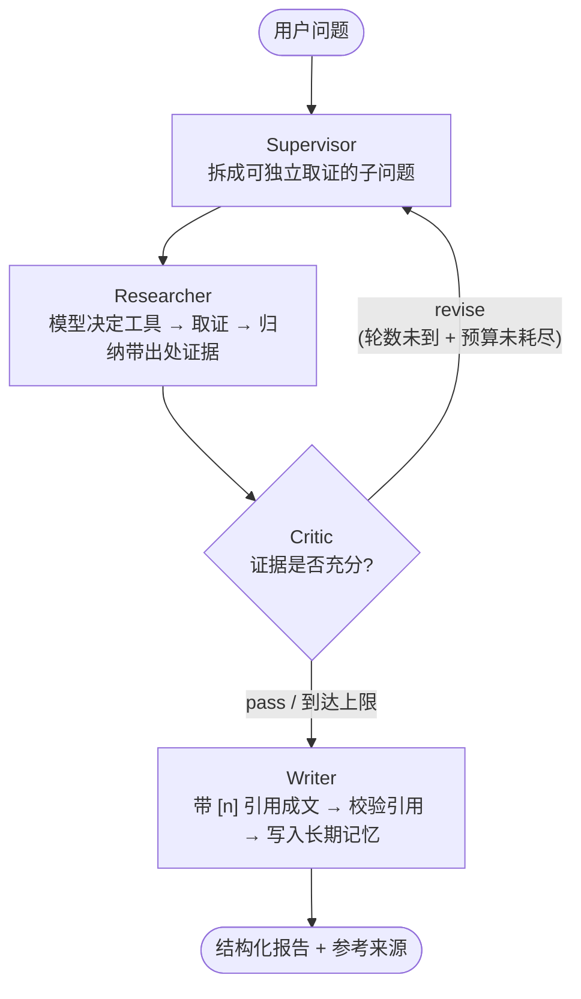

# Argus · 多智能体协同深度研究系统

> 一个用 LangGraph 编排的 **多智能体** 研究系统：输入一个开放式问题，输出一份**每条结论都可溯源**的结构化研究报告。
>
> 设计重心不在"能不能调用 LLM"，而在**多个角色如何分工、如何自我审查与返工、如何防失控、如何让每一次运行都可被复盘**。



---

## 一、这个项目想证明什么

Agent 开发岗真正考察的是"**如何让一个会犯错的系统稳定运行**"，而不是"调用过几次 API"。因此本项目把以下能力做成了**可见、可测、可直接运行**的代码：

| Agent 核心维度 | 本项目的实现 | 代码位置 |
|---|---|---|
| **多智能体编排** | 4 个职责单一的角色 + 图上的条件边，而非单 Agent 循环 | `src/graph/orchestrator.py` |
| **Planning（规划）** | Supervisor 拆子问题；Critic 指出缺口后支持增量重规划 | `src/agents/supervisor.py` |
| **Tool Use（工具调用）** | 由 Router 角色**让模型决定**调哪些工具、用什么关键词 | `src/agents/researcher.py`、`src/tools/registry.py` |
| **自纠错 / Reflection** | Critic 判定 → 回边重取证，最多 N 轮 | `src/agents/critic.py` |
| **短期记忆** | 会话内滑动窗口 + 摘要压缩，跨轮次累积进展 | `src/memory/short_term.py` |
| **长期记忆** | 按用户持久化偏好与已验证事实，下次研究少走一遍 | `src/memory/long_term.py` |
| **护栏 / 安全** | 结构校验、引用真实性校验、拒绝注入的计算器、资源预算 | `src/guardrails/checks.py` |
| **可观测** | 每节点留痕 JSONL（耗时 / token / 成功标记），可接 LangSmith | `src/observability/tracer.py` |
| **可评估** | 出稿率、引用合规率、关键词召回、成本与时长指标 | `src/eval/run_eval.py` |

> 更细的取舍分析、失败模式清单与面试题答法见 [`ARCHITECTURE.md`](./ARCHITECTURE.md)。

---

## 二、目录结构

```
项目二/
├─ src/
│  ├─ agents/          # 四个协作角色 + 共享运行时
│  │  ├─ runtime.py    # LLM / 工具 / trace / 预算 / 会话记忆 的统一入口
│  │  ├─ supervisor.py # 规划：问题 → 可取证子问题
│  │  ├─ researcher.py # 工具路由 + 取证 + 归纳带出处证据
│  │  ├─ critic.py     # 审查：决定是否需要返工
│  │  └─ writer.py     # 成文：带引用 + 引用校验 + 写入长期记忆
│  ├─ graph/           # LangGraph 编排
│  │  ├─ state.py      # 共享黑板 ResearchState
│  │  └─ orchestrator.py
│  ├─ tools/           # retriever(本地KB) / web_search / calculator(AST 白名单)
│  ├─ memory/          # short_term / long_term
│  ├─ guardrails/      # 结构化校验 + 引用校验 + 资源预算
│  ├─ observability/   # JSONL trace（可接 LangSmith）
│  ├─ prompts/         # 集中管理的角色提示词
│  ├─ eval/            # 评测脚本与指标
│  ├─ serving/         # FastAPI + Streamlit
│  └─ cli.py
├─ tests/              # 151 个用例，全部可在无网络无 Key 下通过
├─ data/sample_kb/     # 内置知识库语料（76 个可检索块）
├─ ARCHITECTURE.md     # 深度设计文档：取舍 / 失败模式 / 面试题答法
└─ README.md
```

---

## 三、快速开始

### 获取代码

```bash
git clone https://github.com/Howard-Qin-art/argus-multi-agent-researcher.git
cd argus-multi-agent-researcher
```

### 安装

```bash
pip install -e .
# 可选：服务化 + 评测
pip install -e ".[serve,dev]"
```

### 零成本跑通（推荐先做这一步）

项目内置 **mock provider**：不联网、不需要任何 API Key，用确定性替身模型把整张图跑一遍。这不是玩具，它同时服务于 CI 里的单测。

```bash
python -m src.cli "多智能体系统在生产环境落地的主要难点是什么" --provider mock
```

真实跑一次的输出（mock 模式，占位内容）：

```
┌──────────────── Argus 研究报告 · trace=00fee123b5de ────────────────┐
│ # 研究报告（mock 模式占位输出）                                     │
│ > 当前运行在 mock provider 下…配置真实模型后可得到实际分析。          │
│ ## 结论摘要                                                         │
│ 1. 该问题存在多条技术路线，取舍集中在可控性与效果之间。              │
│ 2. 公开可比数据仍然稀缺，横向评估报告结论差异较大。                  │
│ ## 风险与待验证                                                     │
│ 1. 评测口径不统一导致结论难以直接比较 [1]。                          │
└─────────────────────────────────────────────────────────────────────┘
┌─────────────┬──────┐
│ 指标        │ 数值 │
├─────────────┼──────┤
│ 耗时 (ms)   │   12 │
│ LLM 调用    │   11 │
│ 工具调用    │    4 │
│ 证据条数    │    8 │
│ Critic 轮数 │    1 │
│ 参考来源    │    2 │
│ 引用校验    │ 合规 │
└─────────────┴──────┘
```

### 接入真实模型（国产模型优先）

DeepSeek / 通义千问 / 智谱 都提供 OpenAI 兼容端点，本项目统一走这一层，切换只需改两个环境变量：

```bash
cp .env.example .env
# DeepSeek
export ARGUS_LLM_PROVIDER=deepseek
export ARGUS_LLM_API_KEY=sk-xxxxx
python -m src.cli "同一问题" --provider deepseek

# 通义千问
export ARGUS_LLM_PROVIDER=qwen
export ARGUS_LLM_API_KEY=sk-xxxxx

# 智谱
export ARGUS_LLM_PROVIDER=zhipu
export ARGUS_LLM_API_KEY=xxxxx
```

各 provider 的默认端点与默认模型见 `src/llm.py` 的 `PROVIDER_PRESETS`，也可随时用 `--base-url` / `--model` 覆盖。

### 其他用法

```bash
python -m pytest                                   # 151 passed（约 12s）
python -m src.eval.run_eval --provider mock        # 跑内置评测集并出汇总表
python -m uvicorn src.serving.api:app --port 8000  # REST API
streamlit run src/serving/app.py                   # 可视化界面
docker build -t argus . && docker run -p 8000:8000 argus
python -m src.cli --list-providers                 # 查看所有可用 provider
```

---

## 四、一次运行的完整留痕

打开 `traces/<trace_id>.jsonl`，每一行是一个节点的记录 —— 这也是多智能体最难调试的部分被"摊平"之后的样子：

```
  supervisor   ok=True     2ms tokens_in=15   tokens_out=57
  researcher   ok=True     8ms tokens_in=53   tokens_out=474
  critic       ok=True     0ms tokens_in=16   tokens_out=11
  writer       ok=True     1ms tokens_in=16   tokens_out=128
```

字段包含 `node / started_at / elapsed_ms / ok / error / tokens_in / tokens_out / meta`。
设置 `ARGUS_LANGSMITH=true` 后可一键切到 LangSmith 云端链路。

---

## 五、关键设计取舍

| 决策 | 选择 | 代价 | 理由 |
|---|---|---|---|
| 编排方式 | LangGraph 状态图 | 学习成本 | 条件边天然表达"返工"，checkpoint 支持断点续跑 |
| 角色数量 | 4 个专职角色 | token 成本高于单 Agent | 每步可被单独审查、替换与单测 |
| 工具调用 | 让模型决定（Router） | 多一次 LLM 调用 | 硬编码 pipeline 无法适应真实问题的多样性 |
| 本地检索 | 关键词 + 中文 bigram | 召回质量不及向量库 | 零依赖、零 embedding 服务，clone 即可运行 |
| 计算能力 | AST 白名单求值 | 不支持复杂表达式 | 绝不给 LLM 执行任意代码的能力 |
| 护栏失败 | 降级而非中断 | 可能产出残缺报告 | 研究任务允许部分缺失，但预算不能被无限重试耗尽 |
| 状态结构 | TypedDict + 可序列化 | 类型安全弱于对象 | checkpoint 要求状态可落盘 |

每一条的展开论述在 [`ARCHITECTURE.md`](./ARCHITECTURE.md)。

---

## 六、评测

内置 6 条样本的评测集（`eval/datasets/sample.jsonl`）与 4 类指标：

- **出稿率** —— 是否真的产出可用报告（而非中途崩溃）
- **引用合规率** —— 正文引用编号是否 100% 能在参考列表中找到（防编造文献的硬指标）
- **关键词召回** —— 预期必须覆盖的要点命中比例
- **成本与时延** —— LLM 调用次数、工具调用次数、总耗时，量化每一次改动的代价

```bash
python -m src.eval.run_eval --provider mock --output result.json
```

---

## 七、已知局限（刻意如实列出）

诚实定义一个系统的边界，本身就是工程能力的一部分：

1. 本地检索是关键词 + bigram，**不是语义向量召回**，同义改写可能漏召；
2. Researcher 目前**串行**处理子问题，未做并行化，长任务时延偏高；
3. 评测样本仅 6 条，且**没有接 LLM-as-judge**，自动化评分的可靠性有限；
4. token 是用规则估算（中文约 1 字 1 token），**不是真实计数**；
5. 短期记忆采用抽取式压缩，未调用模型做摘要，保留信息有限；
6. 缺少流式输出与中间过程的前端实时呈现（Streamlit 版为整次跑完后展示）。

---

## 八、后续可拓展方向

- 用 bge-m3 / embedding 替换 `retriever.py` 的打分层，向量化召回（上层接口不变）
- Researcher 子问题并行化（`ThreadPoolExecutor`）+ 全局去重，降低端到端时延
- 接入 LangSmith / Langfuse 做回归评测与成本面板
- 把 Critic 换成两个互相辩论的角色（Peer Debate），对比单一审查者的收益与成本增量
- 引入 RAGAS 等指标做答案可信度的量化

---

## License

MIT
